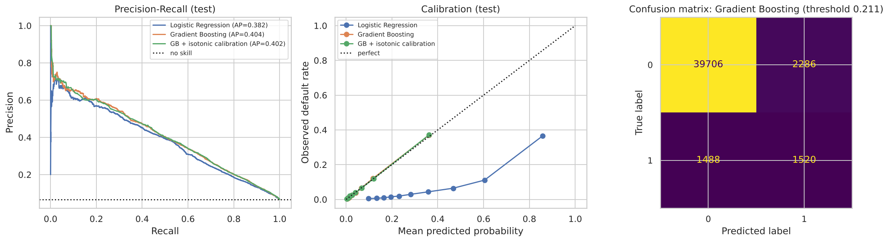
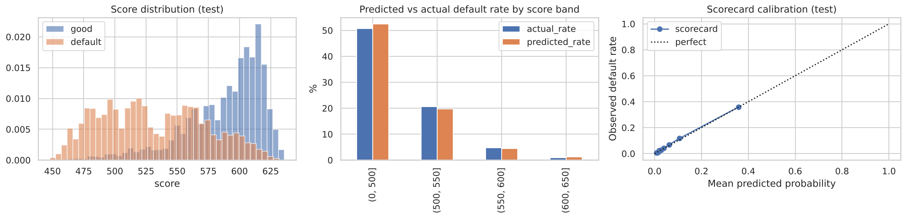
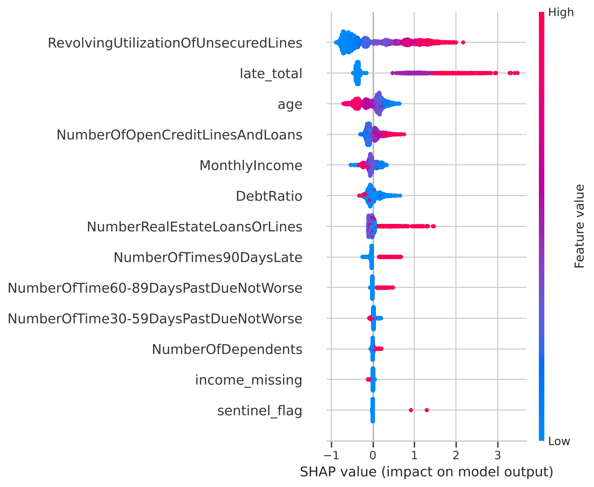
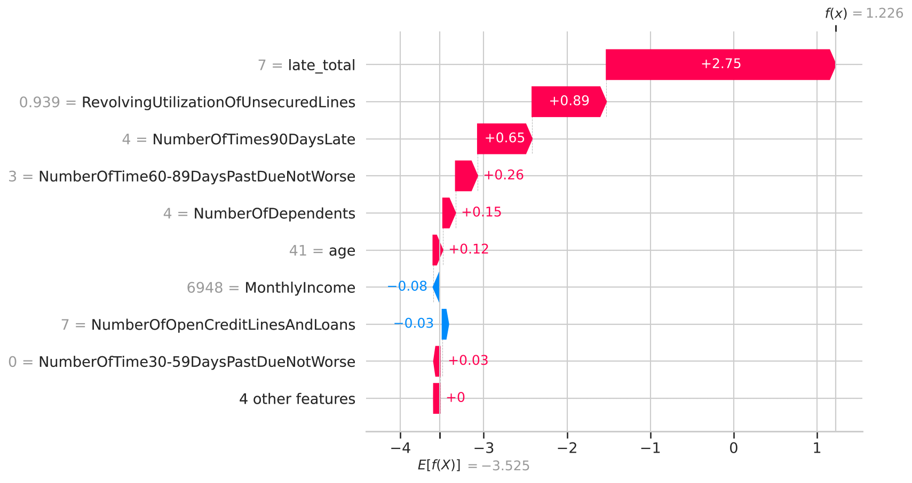

# Credit Default Prediction: Give Me Some Credit

Predict whether a borrower will become 90+ days delinquent within two years, using the Kaggle *Give Me Some Credit* data (150,000 borrowers, 6.7% defaults). The notebook goes from a data audit and leakage-free preprocessing to a gradient-boosting benchmark, a full evaluation beyond AUC, a bank-style WoE/IV points scorecard with its validation, and SHAP explanations.

## Results (30% held-out test set)

| Model | AUC | KS | Avg precision (PR-AUC) |
|---|---|---|---|
| Logistic regression (baseline) | 0.857 | 0.557 | 0.382 |
| WoE/IV scorecard | 0.857 | 0.561 | 0.377 |
| Gradient boosting | 0.866 | 0.577 | 0.404 |
| Gradient boosting + isotonic calibration | 0.867 | 0.576 | 0.402 |

For reference, a no-skill model has an average precision of 0.067 (the default rate).

**Cross-validation (5-fold, training split):** AUC 0.855 ± 0.007 (logistic regression) and 0.865 ± 0.007 (gradient boosting); the preprocessing is refitted inside every fold.

**At a decision threshold** chosen to maximise F1 on out-of-fold *training* predictions (never on the test set), gradient boosting reaches precision 0.40, recall 0.51 and F1 0.45: it catches about half of the defaulters, and about 40% of the borrowers it flags do default.

- **Calibration:** gradient boosting is well calibrated (predicted probabilities match observed default rates). Logistic regression with `class_weight='balanced'` over-predicts risk, so it is used for ranking only.
- **Risk ranking:** the riskiest 10% of borrowers hold 55% of all defaults, the riskiest 20% hold 73%.
- **Main drivers:** past-due history and revolving utilization dominate, then age.

## Scorecard (WoE/IV)

Bins and WoE are learned on the training split only. Points are calibrated so that 600 = 50:1 good:bad odds and +20 points doubles the odds. All coefficients are negative (enforced by an assertion), and train and test AUC are close (0.856 vs 0.857).

| Score band | Borrowers | Actual default rate | Predicted default rate |
|---|---|---|---|
| 0–500 | 1,700 | 50.7% | 52.4% |
| 500–550 | 5,200 | 20.6% | 19.7% |
| 550–600 | 18,815 | 4.8% | 4.4% |
| 600–650 | 19,285 | 0.9% | 1.3% |

The default rate falls with every band, and predicted rates track actual rates.

## SHAP explanations

Global view of which features push default risk up or down (gradient boosting). Revolving utilization and total past-due history are the strongest drivers, followed by age:

One borrower, explained: how each feature moves the prediction from the average to this borrower's risk (log-odds):

## Data issues handled
- **Sentinel codes:** the codes 96/98 appear in exactly the same 269 rows in all three late-payment columns (verified). In the training split these borrowers default at 54.4% (vs 6.6% for the rest), so they are flagged and their counts zeroed instead of dropped. The flag is also a scorecard variable (IV 0.038); without it the scorecard scored these borrowers as clean (predicted 10.2% default vs 54.4% actual on the training split, 54.5% with the flag).
- **Missing values:** `MonthlyIncome` is 19.8% missing and `NumberOfDependents` 2.6%. Income gets a missing-indicator flag plus median fill; dependents are filled with 0.
- **Impossible/extreme values:** one age of 0 is replaced by the median; utilization is capped at 2 and debt ratio at its 99th percentile.
- **No leakage:** the split happens before preprocessing statistics are fitted. All learned preprocessing parameters (medians, debt-ratio cap) and all target-dependent checks (such as the sentinel default rate) use training data only; the initial audit is descriptive and fits nothing. The cleaner sits inside each model's pipeline, so it is refitted in every cross-validation fold. Removing the earlier full-data preprocessing changed the test AUC by less than 0.0001, which confirms the original leak was negligible.
- **Row ID:** `Unnamed: 0` is dropped so row order cannot leak into the model.

## Method
1. Audit the data, then stratified 70/30 split.
2. Leakage-free cleaning (`CreditCleaner`, fitted on the training split).
3. EDA of default rate by utilization, age and past-due history.
4. Logistic regression, gradient boosting and calibrated gradient boosting, with 5-fold cross-validation.
5. Evaluation: AUC, KS, average precision, Brier score, precision, recall, F1, confusion matrix, PR curve, calibration.
6. WoE/IV scorecard and its validation (score distribution, default rate and predicted-vs-actual per band, calibration).
7. SHAP on the gradient boosting model.

## Run it
1. Download `cs-training.csv` from the [Kaggle competition page](https://www.kaggle.com/competitions/GiveMeSomeCredit/data) (join the late submission and accept the rules) and place it next to the notebook or in `data/`.
2. `pip install pandas numpy scikit-learn matplotlib seaborn scipy shap jupyter`
3. Open `Credit_Default_Prediction.ipynb` and run all cells. Plots are saved to `images/`.

## Limitations
- The data is from 2011 and anonymised, with no dates, so there is no out-of-time validation and no Population Stability Index (PSI) over time.
- Age is a model input; real lenders restrict it, and no fairness review was done.
- One hold-out split plus 5-fold CV; hyper-parameters were not tuned.
- Feature engineering was limited to `late_total` and the missing/sentinel flags; interaction features were not explored.
- Kaggle's test labels are not public, so `cs-test.csv` is not used.

## Next
Hyper-parameter tuning, validated feature experiments, a Streamlit demo, and a SQL risk-analysis layer on the same data.
